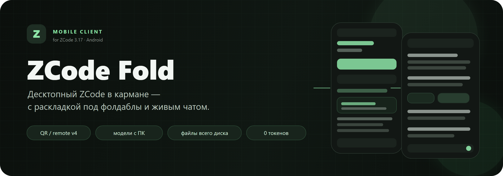
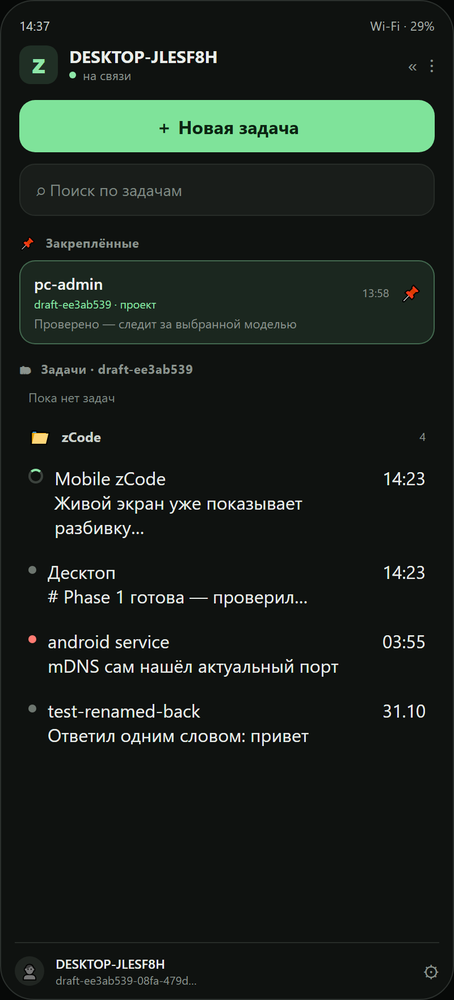
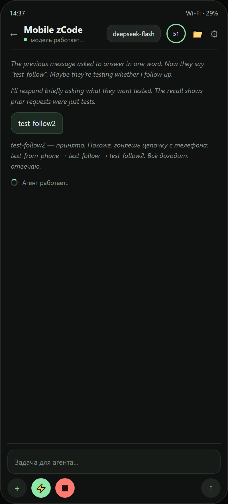
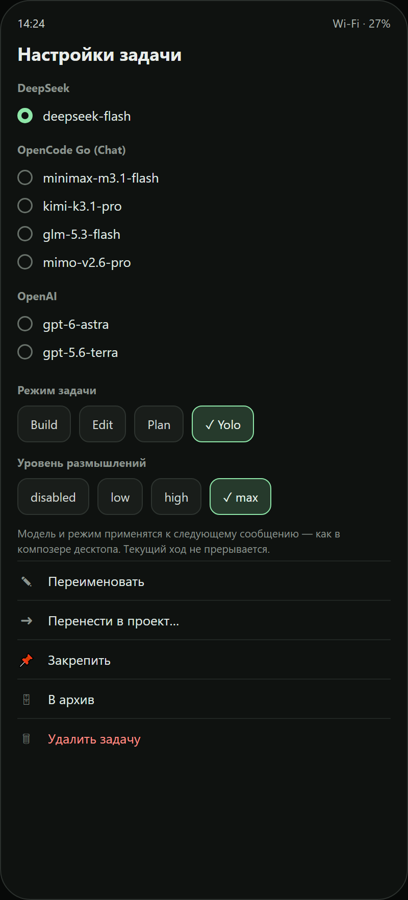
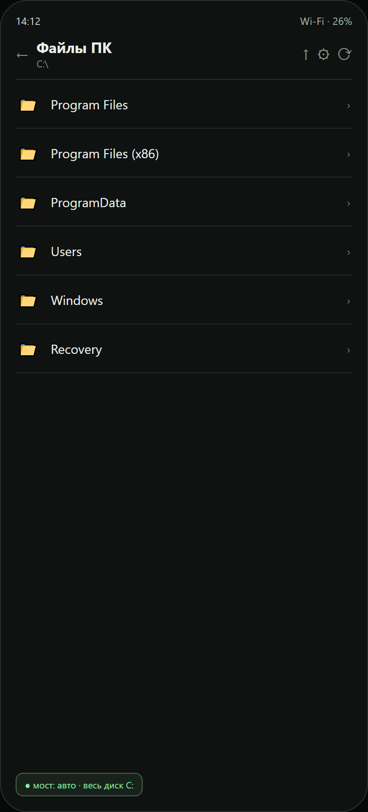
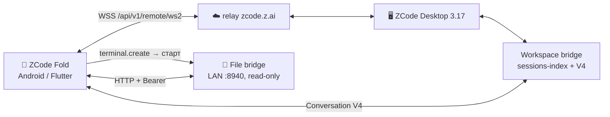
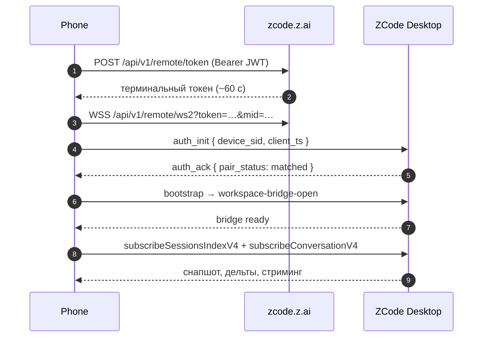
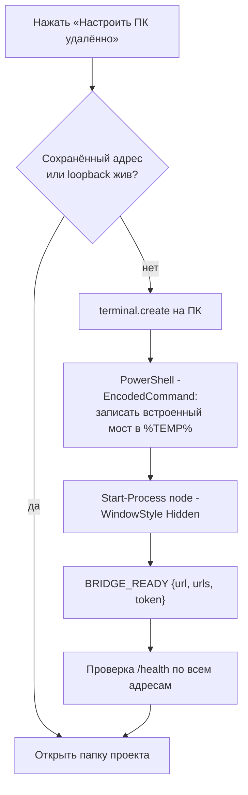

<div align="center">
  
</div>

<div align="center">

[](https://github.com/rukazax/zcode-fold/releases)


**Десктопный ZCode в кармане.** Живой чат с агентом, модели и проекты как на компьютере,
файлы всего ПК — с телефона, без сторонних серверов и подписок.

[Скачать APK](https://github.com/rukazax/zcode-fold/releases/latest) ·
[Быстрый старт](#быстрый-старт) ·
[Если нет связи](#если-нет-связи) ·
[Как устроено](#как-устроено) ·
[Ограничения](#ограничения)

</div>

---

## Что это

ZCode Fold — неофициальный Android-клиент для **ZCode Desktop** (z.ai).
Он подключается к компьютеру по штатному протоколу **ZCode Remote V4**:
никаких hub'ов, прокси и сторонних облаков — только relay `zcode.z.ai`
и уже запущенный ZCode на ПК.

Приложение проектировалось под раскладные телефоны: на внешнем экране — одна
колонка, на внутреннем — две, с учётом шарнира. Работает и на обычных телефонах.

> ⚠️ Проект неофициальный. ZCode — продукт Z.ai. Обновление десктопа может
> сломать совместимость.

## Скриншоты

> Превью интерфейса 0.6.3 по живым экранам Honor Magic V3.

<table>
  <tr>
    <td width="50%" align="center"><br><sub><b>Сайдбар:</b> закреплённые, «Задачи», проекты</sub></td>
    <td width="50%" align="center"><br><sub><b>Чат:</b> тихие размышления и «Агент работает…»</sub></td>
  </tr>
  <tr>
    <td width="50%" align="center"><br><sub><b>Настройки задачи:</b> модели, режим, действия</sub></td>
    <td width="50%" align="center"><br><sub><b>Файлы ПК:</b> весь диск, папка проекта по умолчанию</sub></td>
  </tr>
</table>

## Возможности

| | Возможность | Что делает |
|---|---|---|
| 💬 | **Живой чат V4** | История, стриминг ответов и размышлений, карточки подагентов, подтверждения и формы |
| 🎛 | **Модели как в десктопе** | Каталог `model-selection.getView` прямо с ПК; выбор уходит в следующее сообщение вместе с режимом и reasoning level |
| 🧠 | **Режимы задачи** | build / edit / plan / yolo и уровни размышлений — на задачу, не на приложение |
| 📋 | **Очередь и досыл** | Сообщение во время хода: «+» в очередь или «⚡» сразу в текущий ход, без остановки задачи |
| 🗂 | **Проекты и задачи** | «Закреплённые», «Задачи · проект», остальные проекты; `project.readTree` по живому мосту |
| 🛠 | **Управление задачей** | Переименовать, перенести в другой проект, закрепить, в архив, удалить |
| 📎 | **Файлы с телефона** | Камера, галерея, любые файлы: чанковая загрузка и отправка вместе с текстом |
| 📂 | **Файлы компьютера** | Read-only браузер: папка проекта по умолчанию, корень — весь диск `C:/` |
| ⚡ | **Настройка ПК в один тап** | Приложение само запускает мост на ПК через `terminal` ZCode; без URL, токенов и команд |
| 🔐 | **Безопасность** | JWT и токены в Android Keystore; мост — Bearer-токен, только чтение, лимит 8 МБ |
| 🆓 | **0 токенов за пассивное** | Подключение, списки, история, модели, подтверждения — RPC, а не ходы агента |
| 🌗 | **Тема** | Следует системе; тёмная палитра сохранена 1:1 |
| 📱 | **Фолдаблы** | Одна колонка на внешнем экране, две — на внутреннем; шарнир учитывается |

## Как устроено



**Поток подключения** (штатный remote 3.17):



**Один тап до файлов ПК:**



Приложение **не требует** репозитория или `tools/` на компьютере: скрипт моста
встроен в APK, пишется во временную папку и запускается отсоединённым процессом.

## Протокол

| Слой | Канал / метод | Назначение |
|---|---|---|
| Вход | `POST /api/v1/remote/token` | Терминальный токен по JWT аккаунта |
| Relay | `WSS /api/v1/remote/ws2` | Транспорт телефон ↔ десктоп |
| Bridge | `workspace-bridge-open` | Доступ к workspace |
| Список задач | `subscribeSessionsIndexV4` | Live-индекс задач |
| Диалог | `subscribeConversationV4`, `sendConversationCommandV4` | История, стриминг, команды |
| Модели | `model-selection.getView` | Каталог композера |
| Проекты/задачи | `project.readTree`, `project.moveTask`, `zcode-task.*` | Группировка и действия |
| Файлы ПК | `GET /health`, `/fs/list`, `/fs/read` | Мост только для чтения |

<details>
<summary><b>Почему модель применяется «со следующего сообщения»</b></summary>

В ZCode 3.17 нет команд `switchModelConfig` / `switchCollaborationMode`.
Десктоп держит выбор в черновике композера и отправляет его в payload
следующего `sendText`: `modelSelection`, `mode`, `planEnabled`. ZCode Fold
делает так же — поэтому текущий ход не прерывается, а выбор применяется
к следующей реплике.
</details>

## Быстрый старт

### 1. APK

Скачай `app-release.apk` из [Releases](https://github.com/rukazax/zcode-fold/releases/latest)
и установи на телефон (arm64, debug-подпись для sideload).

### 2. Подключение

1. На ПК открой ZCode → **«Мобильное удалённое управление»** (иконка телефона).
2. Нажми **«Копировать ссылку»** — получишь `https://zcode.z.ai/remote/v4?sid=…`.
3. В приложении: **QR** (камера или картинка из галереи) либо вставь ссылку.
4. Если нужен аккаунт — приложение подскажет; проще всего один раз забрать
   токен с ПК через `tools/bridge.mjs` (одноразовый PIN + QR).

> ⚠️ **QR — это только адрес компьютера.** Для ZCode 3.17 нужен ещё токен
> аккаунта Z.ai: приложение получает его мостом с ПК. Если после сканирования
> видишь «офлайн» и янтарный баннер — жми **«Подключить / войти»** и забери
> токен через `tools/bridge.mjs`. Пошаговый разбор — в
> [docs/TROUBLESHOOTING.md](docs/TROUBLESHOOTING.md).

### 3. Файлы ПК

Ничего вводить не нужно: в шапке чата нажми 📁 → **«Настроить ПК удалённо»**.
Приложение само поднимет мост на компьютере и откроет папку проекта.
Дальше можно подниматься до `C:\` и ходить по всему диску.

## Совместимость

| ZCode Desktop | Подключение | Статус |
|---|---|---|
| **3.17.x** | `/api/v1/remote/ws2` + JWT | ✅ проверено на 3.17.1 |
| 3.16 и ниже | legacy `/ws` + `hash`/`t` (HMAC) | ✅ поддержано |
| Android | 8.0+ (arm64 APK) | ✅ Honor Magic V3, Android 16 |
| iOS | не собирался | ⚠️ код платформенно-нейтральный |

## Если нет связи

| Симптом | Причина | Лечение |
|---|---|---|
| После QR — «офлайн», баннер про токен | Нет JWT аккаунта Z.ai | `node tools/bridge.mjs` → «Подключить / войти» |
| «Мост не отвечает» / таймаут | Мост не запущен, порт занят, firewall | Проверить `/health`, разрешить Node в частной сети |
| Файлы не открываются, телефон в другой сети | VPN/гостевая Wi-Fi | Одна сеть, split tunneling или `adb reverse` |
| `adb connect` таймаут | VPN забирает подсеть телефона | Точечный `route add` через шлюз Wi-Fi |
| Связь есть, задач нет | В ZCode не открыт проект | Открыть workspace на ПК, потянуть список вниз |
| Через время снова офлайн | JWT/терминальный токен истёк | Переподключиться, обновить токен мостом |

📖 Подробно, с командами и проверкой маршрутов — [docs/TROUBLESHOOTING.md](docs/TROUBLESHOOTING.md).

## Проверено на живом устройстве

| Сценарий | Результат |
|---|---|
| Pairing 3.17 через `/ws2` | ✅ `pair_status: matched` |
| QR без токена → мост → автоподключение | ✅ баннер, затем «на связи» без перезапуска |
| Список задач, проекты, закреплённые | ✅ live + сохранение после рестарта |
| История, стриминг, размышления | ✅ |
| Отправка задачи с телефона | ✅ агент ответил |
| Каталог моделей с ПК | ✅ OpenAI / OpenCode / DeepSeek |
| Переименование задачи | ✅ заголовок обновился на ПК |
| Досыл «⚡» в работающий ход | ✅ агент получил уточнение |
| Файлы ПК: автонастройка + `C:\` | ✅ весь диск |
| Камера / галерея во вложениях | ✅ |
| Две колонки и шарнир | ✅ 719 × 781 dp, вертикальный шарнир |

## Разработка

```bash
cd app
flutter pub get
flutter test          # 57 тестов протокола
flutter analyze
flutter run
flutter build apk --release --target-platform android-arm64
```

| Путь | Что внутри |
|---|---|
| `app/lib/src/app_state.dart` | Подключение, workspace, V4-команды, очередь, проекты, автонастройка ПК |
| `app/lib/src/zcode/` | Протокол Remote V4 (IPC, RPC-кадры, Conversation, вложения) |
| `app/lib/src/ui/` | Адаптивный shell, сайдбар, чат, настройки задачи, файлы |
| `app/lib/src/pc_bridge_script.dart` | Встроенный мини-мост для файлов ПК |
| `tools/bridge.mjs` | Полноценный мост для ПК (файлы + модели, ручной запуск) |
| `docs/assets/` | Баннер и превью интерфейса |

### Сборка тулчейна

Проект собирается портативным Flutter 3.47.9 + JDK 21 + Android SDK 36 / NDK 28.2.
Windows без Visual Studio: цель — Android. Инструкции по установке тулчейна — в
[RESEARCH.md](RESEARCH.md) и истории коммитов.

## Ограничения

| Ограничение | Детали |
|---|---|
| Неофициальный протокол | Обновление ZCode может сломать совместимость |
| Нужен онлайн-ПК | ZCode запущен, панель мобильного доступа открыта |
| Файлы ПК | Нужен запущенный мост; автонастройка запускает его сама |
| Подпись APK | Debug-ключ, не Google Play |
| iOS | Не собирался |

## Что нового

- **0.6.5** — пины из sessions-index и project.readTree объединяются, десктопный pinned имеет приоритет.
- **0.6.4** — закреплённые с ПК синхронизируются: флаг pinned из project.readTree, пин/анпин через setTaskPinned.
- **0.6.3** — понятная ошибка «нет токена Z.ai», автоподключение после моста, защита от дублей устройств.
- **0.6.2** — секции «Закреплённые»/«Задачи», автономная настройка файлов ПК в один тап, обзор всего диска.
- **0.6.0** — модели как в десктопе, проекты, управление задачей, тихий чат, камера.
- **0.5.0** — десктопный сайдбар, очередь, вложения, темы.
- Полная история — в [Releases](https://github.com/rukazax/zcode-fold/releases).

## Лицензия

MIT. Протокол адаптирован из [Zemote](https://github.com/HumanAILoop/zemote) —
см. [THIRD_PARTY.md](THIRD_PARTY.md). ZCode — продукт Z.ai, проект неофициальный.
