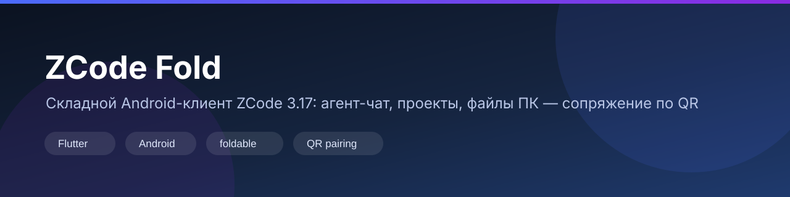
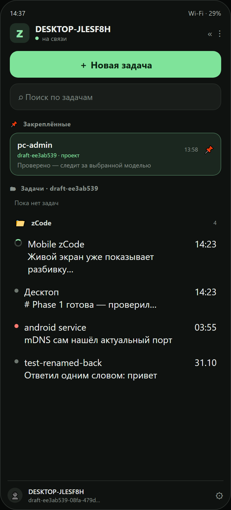
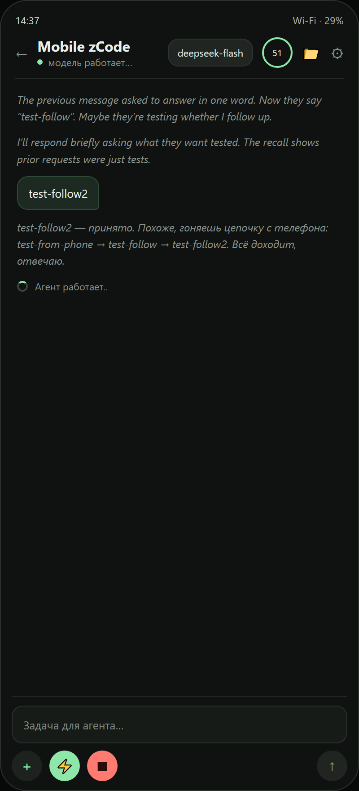
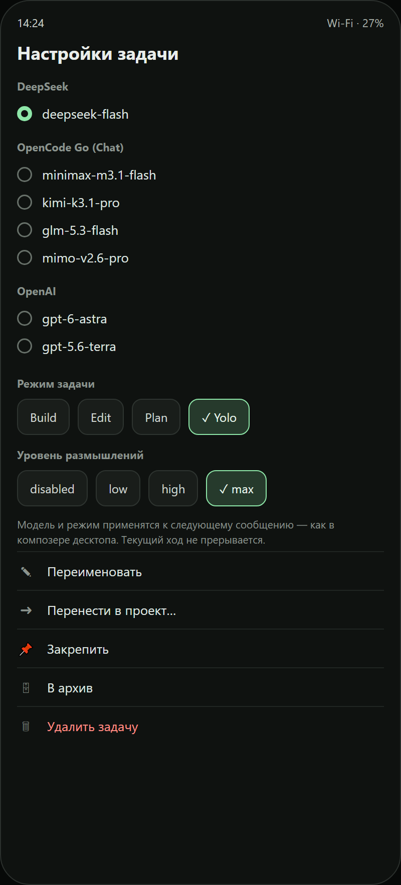
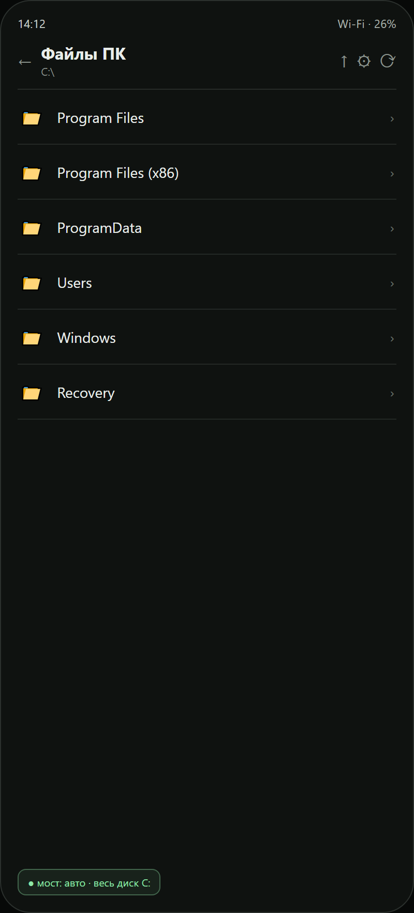
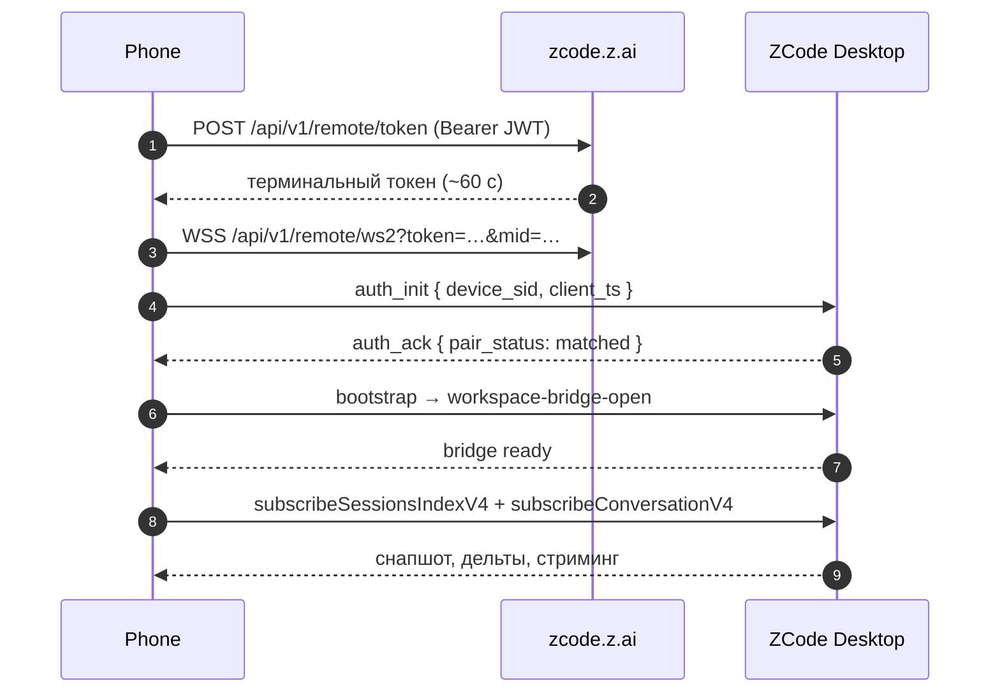
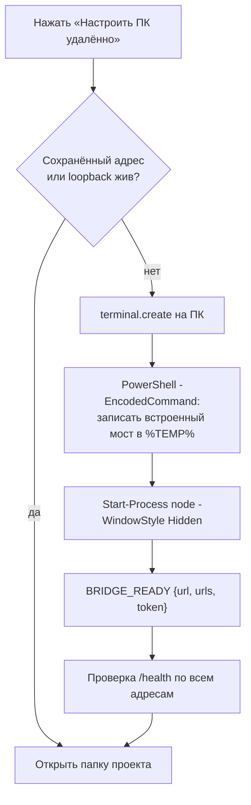
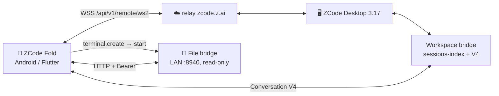
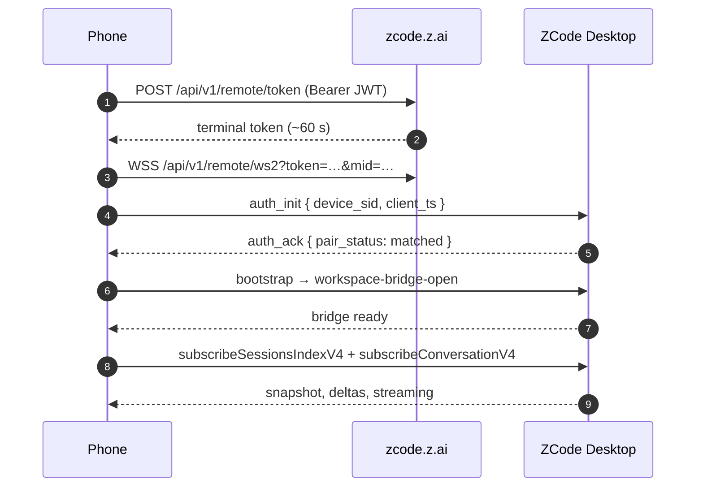
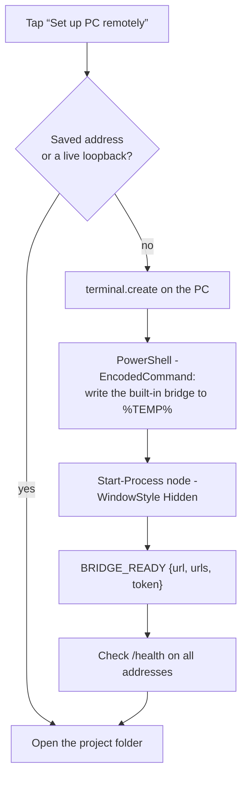

**← [Все проекты · All projects](https://github.com/rukazax?tab=repositories)**

<div align="center">
  
</div>

# 📱 ZCode Fold — десктопный ZCode в кармане

**RU** · [English](#english)

<div align="center">

[](https://github.com/rukazax)
[](https://github.com/rukazax/zcode-fold/releases)
[](#быстрый-старт)
[](#разработка)
[](#разработка)
[](#лицензия)

</div>

> **Десктопный ZCode в кармане:** живой чат с агентом, модели и проекты как на компьютере, файлы всего ПК — с телефона. QR-сопряжение, без сторонних серверов и подписок.

| Раздел | О чём |
| --- | --- |
| 💡 [Что это](#что-это) | Клиент ZCode Remote V4, дизайн под фолдаблы |
| 📸 [Скриншоты](#скриншоты) | Экраны интерфейса 0.6.3 |
| ✨ [Возможности](#возможности) | Чат, модели, проекты, файлы, безопасность |
| ⚙️ [Как устроено](#как-устроено) | Схемы подключения и автоподъём моста |
| 📡 [Протокол](#протокол) | Каналы и методы Remote V4 |
| 🚀 [Быстрый старт](#быстрый-старт) | APK, QR-сопряжение, файлы ПК |
| 🧩 [Совместимость](#совместимость) | Версии ZCode Desktop и устройств |
| 🩺 [Если нет связи](#если-нет-связи) | Симптомы и лечение |
| ✅ [Проверено на живом устройстве](#проверено-на-живом-устройстве) | Сценарии и результаты |
| 🛠 [Разработка](#разработка) | Команды и структура кода |
| ⚠️ [Ограничения](#ограничения) | Что важно знать |
| 🗒 [Что нового](#что-нового) | История версий |
| ⚖️ [Лицензия](#лицензия) | MIT и заимствования |

---

## Что это

ZCode Fold — неофициальный Android-клиент для **ZCode Desktop** (z.ai).
Он подключается к компьютеру по штатному протоколу **ZCode Remote V4**:
никаких hub'ов, прокси и сторонних облаков — только relay `zcode.z.ai`
и уже запущенный ZCode на ПК.

Приложение проектировалось под раскладные телефоны: на внешнем экране — одна
колонка, на внутреннем — две, с учётом шарнира. Работает и на обычных телефонах.

> ⚠️ Проект неофициальный. ZCode — продукт Z.ai. Обновление десктопа может
> сломать совместимость.

## Скриншоты

> Превью интерфейса 0.6.3 по живым экранам Honor Magic V3.

<table>
  <tr>
    <td width="50%" align="center"><br><sub><b>Сайдбар:</b> закреплённые, «Задачи», проекты</sub></td>
    <td width="50%" align="center"><br><sub><b>Чат:</b> тихие размышления и «Агент работает…»</sub></td>
  </tr>
  <tr>
    <td width="50%" align="center"><br><sub><b>Настройки задачи:</b> модели, режим, действия</sub></td>
    <td width="50%" align="center"><br><sub><b>Файлы ПК:</b> весь диск, папка проекта по умолчанию</sub></td>
  </tr>
</table>

## Возможности

| | Возможность | Что делает |
|---|---|---|
| 💬 | **Живой чат V4** | История, стриминг ответов и размышлений, карточки подагентов, подтверждения и формы |
| 🎛 | **Модели как в десктопе** | Каталог `model-selection.getView` прямо с ПК; выбор уходит в следующее сообщение вместе с режимом и reasoning level |
| 🧠 | **Режимы задачи** | build / edit / plan / yolo и уровни размышлений — на задачу, не на приложение |
| 📋 | **Очередь и досыл** | Сообщение во время хода: «+» в очередь или «⚡» сразу в текущий ход, без остановки задачи |
| 🗂 | **Проекты и задачи** | «Закреплённые», «Задачи · проект», остальные проекты; `project.readTree` по живому мосту |
| 🛠 | **Управление задачей** | Переименовать, перенести в другой проект, закрепить, в архив, удалить |
| 📎 | **Файлы с телефона** | Камера, галерея, любые файлы: чанковая загрузка и отправка вместе с текстом |
| 📂 | **Файлы компьютера** | Read-only браузер: папка проекта по умолчанию, корень — весь диск `C:/` |
| ⚡ | **Настройка ПК в один тап** | Приложение само запускает мост на ПК через `terminal` ZCode; без URL, токенов и команд |
| 🔐 | **Безопасность** | JWT и токены в Android Keystore; мост — Bearer-токен, только чтение, лимит 8 МБ |
| 🆓 | **0 токенов за пассивное** | Подключение, списки, история, модели, подтверждения — RPC, а не ходы агента |
| 🌗 | **Тема** | Следует системе; тёмная палитра сохранена 1:1 |
| 📱 | **Фолдаблы** | Одна колонка на внешнем экране, две — на внутреннем; шарнир учитывается |

## Как устроено


**Поток подключения** (штатный remote 3.17):



**Один тап до файлов ПК:**



Приложение **не требует** репозитория или `tools/` на компьютере: скрипт моста
встроен в APK, пишется во временную папку и запускается отсоединённым процессом.

## Протокол

| Слой | Канал / метод | Назначение |
|---|---|---|
| Вход | `POST /api/v1/remote/token` | Терминальный токен по JWT аккаунта |
| Relay | `WSS /api/v1/remote/ws2` | Транспорт телефон ↔ десктоп |
| Bridge | `workspace-bridge-open` | Доступ к workspace |
| Список задач | `subscribeSessionsIndexV4` | Live-индекс задач |
| Диалог | `subscribeConversationV4`, `sendConversationCommandV4` | История, стриминг, команды |
| Модели | `model-selection.getView` | Каталог композера |
| Проекты/задачи | `project.readTree`, `project.moveTask`, `zcode-task.*` | Группировка и действия |
| Файлы ПК | `GET /health`, `/fs/list`, `/fs/read` | Мост только для чтения |

<details>
<summary><b>Почему модель применяется «со следующего сообщения»</b></summary>

В ZCode 3.17 нет команд `switchModelConfig` / `switchCollaborationMode`.
Десктоп держит выбор в черновике композера и отправляет его в payload
следующего `sendText`: `modelSelection`, `mode`, `planEnabled`. ZCode Fold
делает так же — поэтому текущий ход не прерывается, а выбор применяется
к следующей реплике.
</details>

## Быстрый старт

### 1. APK

Скачай `app-release.apk` из [Releases](https://github.com/rukazax/zcode-fold/releases/latest)
и установи на телефон (arm64, debug-подпись для sideload).

### 2. Подключение

1. На ПК открой ZCode → **«Мобильное удалённое управление»** (иконка телефона).
2. Нажми **«Копировать ссылку»** — получишь `https://zcode.z.ai/remote/v4?sid=…`.
3. В приложении: **QR** (камера или картинка из галереи) либо вставь ссылку.
4. Если нужен аккаунт — приложение подскажет; проще всего один раз забрать
   токен с ПК через `tools/bridge.mjs` (одноразовый PIN + QR).

> ⚠️ **QR — это только адрес компьютера.** Для ZCode 3.17 нужен ещё токен
> аккаунта Z.ai: приложение получает его мостом с ПК. Если после сканирования
> видишь «офлайн» и янтарный баннер — жми **«Подключить / войти»** и забери
> токен через `tools/bridge.mjs`. Пошаговый разбор — в
> [docs/TROUBLESHOOTING.md](docs/TROUBLESHOOTING.md).

### 3. Файлы ПК

Ничего вводить не нужно: в шапке чата нажми 📁 → **«Настроить ПК удалённо»**.
Приложение само поднимет мост на компьютере и откроет папку проекта.
Дальше можно подниматься до `C:\` и ходить по всему диску.

## Совместимость

| ZCode Desktop | Подключение | Статус |
|---|---|---|
| **3.17.x** | `/api/v1/remote/ws2` + JWT | ✅ проверено на 3.17.1 |
| 3.16 и ниже | legacy `/ws` + `hash`/`t` (HMAC) | ✅ поддержано |
| Android | 8.0+ (arm64 APK) | ✅ Honor Magic V3, Android 16 |
| iOS | не собирался | ⚠️ код платформенно-нейтральный |

## Если нет связи

| Симптом | Причина | Лечение |
|---|---|---|
| После QR — «офлайн», баннер про токен | Нет JWT аккаунта Z.ai | `node tools/bridge.mjs` → «Подключить / войти» |
| «Мост не отвечает» / таймаут | Мост не запущен, порт занят, firewall | Проверить `/health`, разрешить Node в частной сети |
| Файлы не открываются, телефон в другой сети | VPN/гостевая Wi-Fi | Одна сеть, split tunneling или `adb reverse` |
| `adb connect` таймаут | VPN забирает подсеть телефона | Точечный `route add` через шлюз Wi-Fi |
| Связь есть, задач нет | В ZCode не открыт проект | Открыть workspace на ПК, потянуть список вниз |
| Через время снова офлайн | JWT/терминальный токен истёк | Переподключиться, обновить токен мостом |

📖 Подробно, с командами и проверкой маршрутов — [docs/TROUBLESHOOTING.md](docs/TROUBLESHOOTING.md).

## Проверено на живом устройстве

| Сценарий | Результат |
|---|---|
| Pairing 3.17 через `/ws2` | ✅ `pair_status: matched` |
| QR без токена → мост → автоподключение | ✅ баннер, затем «на связи» без перезапуска |
| Список задач, проекты, закреплённые | ✅ live + сохранение после рестарта |
| История, стриминг, размышления | ✅ |
| Отправка задачи с телефона | ✅ агент ответил |
| Каталог моделей с ПК | ✅ OpenAI / OpenCode / DeepSeek |
| Переименование задачи | ✅ заголовок обновился на ПК |
| Досыл «⚡» в работающий ход | ✅ агент получил уточнение |
| Файлы ПК: автонастройка + `C:\` | ✅ весь диск |
| Камера / галерея во вложениях | ✅ |
| Две колонки и шарнир | ✅ 719 × 781 dp, вертикальный шарнир |

## Разработка

```bash
cd app
flutter pub get
flutter test          # 57 тестов протокола
flutter analyze
flutter run
flutter build apk --release --target-platform android-arm64
```

| Путь | Что внутри |
|---|---|
| `app/lib/src/app_state.dart` | Подключение, workspace, V4-команды, очередь, проекты, автонастройка ПК |
| `app/lib/src/zcode/` | Протокол Remote V4 (IPC, RPC-кадры, Conversation, вложения) |
| `app/lib/src/ui/` | Адаптивный shell, сайдбар, чат, настройки задачи, файлы |
| `app/lib/src/pc_bridge_script.dart` | Встроенный мини-мост для файлов ПК |
| `tools/bridge.mjs` | Полноценный мост для ПК (файлы + модели, ручной запуск) |
| `docs/assets/` | Баннер и превью интерфейса |

### Сборка тулчейна

Проект собирается портативным Flutter 3.47.9 + JDK 21 + Android SDK 36 / NDK 28.2.
Windows без Visual Studio: цель — Android. Инструкции по установке тулчейна — в
[RESEARCH.md](RESEARCH.md) и истории коммитов.

## Ограничения

| Ограничение | Детали |
|---|---|
| Неофициальный протокол | Обновление ZCode может сломать совместимость |
| Нужен онлайн-ПК | ZCode запущен, панель мобильного доступа открыта |
| Файлы ПК | Нужен запущенный мост; автонастройка запускает его сама |
| Подпись APK | Debug-ключ, не Google Play |
| iOS | Не собирался |

## Что нового

- **0.6.5** — закреплённые с ПК: флаг pinned из project.readTree (включая задачи вне проектов), пин/анпин через setTaskPinned, sessions-index как fallback.
- **0.6.4** — закреплённые с ПК синхронизируются: флаг pinned из project.readTree, пин/анпин через setTaskPinned.
- **0.6.3** — понятная ошибка «нет токена Z.ai», автоподключение после моста, защита от дублей устройств.
- **0.6.2** — секции «Закреплённые»/«Задачи», автономная настройка файлов ПК в один тап, обзор всего диска.
- **0.6.0** — модели как в десктопе, проекты, управление задачей, тихий чат, камера.
- **0.5.0** — десктопный сайдбар, очередь, вложения, темы.
- Полная история — в [Releases](https://github.com/rukazax/zcode-fold/releases).

## Лицензия

MIT. Протокол адаптирован из [Zemote](https://github.com/HumanAILoop/zemote) —
см. [THIRD_PARTY.md](THIRD_PARTY.md). ZCode — продукт Z.ai, проект неофициальный.

## English

### What it is

ZCode Fold is an unofficial Android client for **ZCode Desktop** (z.ai).
It connects to the computer over the stock **ZCode Remote V4** protocol:
no hubs, proxies or third-party clouds — only the `zcode.z.ai` relay
and the ZCode already running on the PC.

The app was designed for foldables: one column on the outer screen, two on
the inner one, hinge-aware. It works on regular phones too.

> ⚠️ Unofficial project. ZCode is a product of Z.ai. A desktop update may
> break compatibility.

### Screenshots

> UI preview of 0.6.3 captured from the live screens of an Honor Magic V3.

<table>
  <tr>
    <td width="50%" align="center"><br><sub><b>Sidebar:</b> pinned, “Tasks”, projects</sub></td>
    <td width="50%" align="center"><br><sub><b>Chat:</b> quiet thinking and “The agent is working…”</sub></td>
  </tr>
  <tr>
    <td width="50%" align="center"><br><sub><b>Task settings:</b> models, mode, actions</sub></td>
    <td width="50%" align="center"><br><sub><b>PC files:</b> the whole drive, project folder by default</sub></td>
  </tr>
</table>

### Features

| | Feature | What it does |
|---|---|---|
| 💬 | **Live V4 chat** | History, streaming of replies and thinking, subagent cards, confirmations and forms |
| 🎛 | **Models like on the desktop** | The `model-selection.getView` catalog straight from the PC; the choice is sent with the next message together with the mode and reasoning level |
| 🧠 | **Task modes** | build / edit / plan / yolo and thinking levels — per task, not per app |
| 📋 | **Queue and follow-up** | A message during a run: “+” queues it or “⚡” sends it straight into the current run without stopping the task |
| 🗂 | **Projects and tasks** | “Pinned”, “Tasks · project”, other projects; `project.readTree` over the live bridge |
| 🛠 | **Task management** | Rename, move to another project, pin, archive, delete |
| 📎 | **Files from the phone** | Camera, gallery, any files: chunked upload and sending together with the text |
| 📂 | **Computer files** | Read-only browser: project folder by default, root — the whole `C:/` drive |
| ⚡ | **One-tap PC setup** | The app starts the bridge on the PC itself via ZCode's `terminal`; no URLs, tokens or commands |
| 🔐 | **Security** | JWT and tokens in Android Keystore; the bridge — a Bearer token, read-only, 8 MB limit |
| 🆓 | **0 tokens for passive use** | Connection, lists, history, models, confirmations — RPC, not agent runs |
| 🌗 | **Theme** | Follows the system; the dark palette is preserved 1:1 |
| 📱 | **Foldables** | One column on the outer screen, two on the inner one; the hinge is respected |

### How it works



**Connection flow** (stock remote 3.17):



**One tap to PC files:**



The app does **not** require a repository or `tools/` on the computer: the bridge
script is embedded in the APK, written to a temporary folder and started as a
detached process.

### Protocol

| Layer | Channel / method | Purpose |
|---|---|---|
| Entry | `POST /api/v1/remote/token` | Terminal token from the account JWT |
| Relay | `WSS /api/v1/remote/ws2` | Transport phone ↔ desktop |
| Bridge | `workspace-bridge-open` | Workspace access |
| Task list | `subscribeSessionsIndexV4` | Live task index |
| Conversation | `subscribeConversationV4`, `sendConversationCommandV4` | History, streaming, commands |
| Models | `model-selection.getView` | Composer catalog |
| Projects/tasks | `project.readTree`, `project.moveTask`, `zcode-task.*` | Grouping and actions |
| PC files | `GET /health`, `/fs/list`, `/fs/read` | Read-only bridge |

<details>
<summary><b>Why the model applies “from the next message”</b></summary>

ZCode 3.17 has no `switchModelConfig` / `switchCollaborationMode` commands.
The desktop keeps the choice in the composer draft and sends it in the payload
of the next `sendText`: `modelSelection`, `mode`, `planEnabled`. ZCode Fold
does the same — the current run is not interrupted, and the choice applies
to the next message.
</details>

### Quick start

#### 1. APK

Download `app-release.apk` from [Releases](https://github.com/rukazax/zcode-fold/releases/latest)
and install it on the phone (arm64, debug signature for sideload).

#### 2. Connection

1. On the PC open ZCode → **“Mobile remote control”** (the phone icon).
2. Tap **“Copy link”** — you get `https://zcode.z.ai/remote/v4?sid=…`.
3. In the app: **QR** (camera or a picture from the gallery) or paste the link.
4. If an account is needed, the app will tell you; the simplest way is to grab
   the token from the PC once via `tools/bridge.mjs` (one-time PIN + QR).

> ⚠️ **The QR is only the computer's address.** ZCode 3.17 also needs a Z.ai
> account token: the app gets it over the bridge from the PC. If after scanning
> you see “offline” and an amber banner — tap **“Connect / sign in”** and grab
> the token via `tools/bridge.mjs`. A step-by-step walkthrough is in
> [docs/TROUBLESHOOTING.md](docs/TROUBLESHOOTING.md).

#### 3. PC files

Nothing to enter: in the chat header tap 📁 → **“Set up PC remotely”**.
The app raises the bridge on the computer by itself and opens the project
folder. From there you can go up to `C:\` and walk the whole drive.

### Compatibility

| ZCode Desktop | Connection | Status |
|---|---|---|
| **3.17.x** | `/api/v1/remote/ws2` + JWT | ✅ verified on 3.17.1 |
| 3.16 and below | legacy `/ws` + `hash`/`t` (HMAC) | ✅ supported |
| Android | 8.0+ (arm64 APK) | ✅ Honor Magic V3, Android 16 |
| iOS | not built | ⚠️ the code is platform-neutral |

### No connection?

| Symptom | Cause | Fix |
|---|---|---|
| After the QR — “offline”, a banner about a token | No Z.ai account JWT | `node tools/bridge.mjs` → “Connect / sign in” |
| “Bridge not responding” / timeout | Bridge not running, port taken, firewall | Check `/health`, allow Node on the private network |
| Files don't open, the phone is on another network | VPN / guest Wi-Fi | One network, split tunneling or `adb reverse` |
| `adb connect` timeout | The VPN takes the phone's subnet | A targeted `route add` via the Wi-Fi gateway |
| Connection is fine, no tasks | No project open in ZCode | Open the workspace on the PC, pull the list down |
| Goes offline again after a while | The JWT / terminal token expired | Reconnect, refresh the token via the bridge |

📖 In detail, with commands and route checks — [docs/TROUBLESHOOTING.md](docs/TROUBLESHOOTING.md).

### Verified on a live device

| Scenario | Result |
|---|---|
| 3.17 pairing via `/ws2` | ✅ `pair_status: matched` |
| QR without a token → bridge → auto-reconnect | ✅ banner, then “connected” without a restart |
| Task list, projects, pinned | ✅ live + preserved after a restart |
| History, streaming, thinking | ✅ |
| Sending a task from the phone | ✅ the agent replied |
| Model catalog from the PC | ✅ OpenAI / OpenCode / DeepSeek |
| Renaming a task | ✅ the title updated on the PC |
| “⚡” follow-up into a running task | ✅ the agent got the clarification |
| PC files: auto setup + `C:\` | ✅ the whole drive |
| Camera / gallery attachments | ✅ |
| Two columns and the hinge | ✅ 719 × 781 dp, vertical hinge |

### Development

```bash
cd app
flutter pub get
flutter test          # 57 protocol tests
flutter analyze
flutter run
flutter build apk --release --target-platform android-arm64
```

| Path | What's inside |
|---|---|
| `app/lib/src/app_state.dart` | Connection, workspace, V4 commands, queue, projects, PC auto setup |
| `app/lib/src/zcode/` | Remote V4 protocol (IPC, RPC frames, Conversation, attachments) |
| `app/lib/src/ui/` | Adaptive shell, sidebar, chat, task settings, files |
| `app/lib/src/pc_bridge_script.dart` | Built-in mini-bridge for PC files |
| `tools/bridge.mjs` | Full bridge for the PC (files + models, manual start) |
| `docs/assets/` | Banner and UI previews |

#### Toolchain build

The project builds with portable Flutter 3.47.9 + JDK 21 + Android SDK 36 / NDK 28.2.
Windows without Visual Studio: the target is Android. Toolchain install
instructions — in [RESEARCH.md](RESEARCH.md) and the commit history.

### Limitations

| Limitation | Details |
|---|---|
| Unofficial protocol | A ZCode update may break compatibility |
| An online PC is required | ZCode running, the mobile access panel open |
| PC files | A running bridge is needed; auto setup starts it by itself |
| APK signing | Debug key, not Google Play |
| iOS | Not built |

### What's new

- **0.6.5** — pinned from the PC: the pinned flag from project.readTree (including tasks outside projects), pin/unpin via setTaskPinned, sessions-index as a fallback.
- **0.6.4** — pinned items sync from the PC: the pinned flag from project.readTree, pin/unpin via setTaskPinned.
- **0.6.3** — a clear “no Z.ai token” error, auto-reconnect after the bridge, protection against duplicate devices.
- **0.6.2** — “Pinned”/“Tasks” sections, one-tap autonomous PC file setup, whole-drive browsing.
- **0.6.0** — models like on the desktop, projects, task management, quiet chat, camera.
- **0.5.0** — desktop sidebar, queue, attachments, themes.
- Full history — in [Releases](https://github.com/rukazax/zcode-fold/releases).

### License

MIT. The protocol is adapted from [Zemote](https://github.com/HumanAILoop/zemote) —
see [THIRD_PARTY.md](THIRD_PARTY.md). ZCode is a product of Z.ai; the project is unofficial.

---

#android #flutter #foldable #zcode #z-ai #ai-agent #remote-control #mobile-client #qr-pairing #zcode-remote-v4 #sideload
