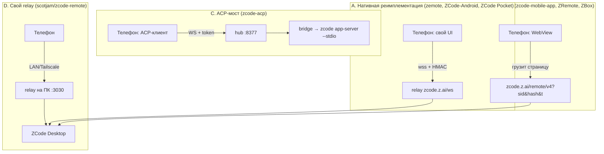

# Мобильные клиенты для ZCode: топ-5 и разбор принципов работы

**Дата:** 31.10.2026 · **Источник:** GitHub API (звёзды/релизы/даты — сняты на эту дату)
**Контекст:** у ZCode (z.ai) есть официальный «Mobile remote control» — веб-страница `https://zcode.z.ai/remote/v4?sid=…&hash=…&t=…&mid=…`, которую открывают с телефона в браузере. Нативного мобильного приложения у ZCode нет, поэтому всё, что ниже — сторонние клиенты вокруг этого механизма. Ниша молодая (репозитории массово появились с августа 2026), поэтому звёзды маленькие и **звёзды — плохой критерий**. Сортировал по совокупности: полнота реализации, архитектура, живость проекта, наличие собираемых APK.

---

## Сводная таблица

| # | Проект | ⭐ | Стек | Архитектура | Android APK | Лицензия | Живость |
|---|--------|----|------|-------------|-------------|----------|---------|
| 1 | [HumanAILoop/zemote](https://github.com/HumanAILoop/zemote) | 99 | Flutter / Dart | Нативный клиент: полная реимплементация протокола remote/v4 | да (CI, 6 файлов в релизе) | MIT | пуш 18.09.26 |
| 2 | [william0wang/zcode-acp](https://github.com/william0wang/zcode-acp) + [zcode-acp-app](https://github.com/william0wang/zcode-acp-app) | 78 + 6 | TypeScript / Rust / Tauri+React | ACP-бридж над официальным headless `zcode app-server --stdio`, hub на WebSocket | да | Apache-2.0 / MIT | v0.80.1, пуш 30.10.26 |
| 3 | [my-dlq/zcode-mobile-app](https://github.com/my-dlq/zcode-mobile-app) | 27 | Kotlin + WebView | Обёртка официальной remote-страницы + нативная обвязка (уведомления, keep-alive, БД) | да (Releases) | MIT | v0.3.2, пуш 27.10.26 |
| 4 | [vimalinx/zcodepocket](https://github.com/vimalinx/zcodepocket) | 9 | React Native (Expo 57) | Нативный UI, но ходит напрямую в официальный `wss://zcode.z.ai/ws` | да (arm64) | MIT | v1.0.8, пуш 07.09.26 |
| 5 | [Damianjiang/ZCode-Android](https://github.com/Damianjiang/ZCode-Android) | 6 | Kotlin + Compose M3 | Нативный клиент, протокол воспроизведён вручную (v1.9.6) | да (v1.9.6) | MIT | пуш 03.10.26 |

Запасной ряд (тоже достойные, но не вошли): `woshihoujinxin/zcode-mobile-android` (Java-обёртка + APK, мультидевайс), `245678000000/ZCode-Mobile` (8⭐, Compose-обёртка с уведомлениями), `winniesi/zbox` (изоляция WebView-профилей на устройство), `scotjam/zcode-remote` (свой relay вместо облака Z.ai), `huanghao680/phone-agent` (ZCode целиком внутри APK).

---

## Принципы работы: четыре архитектурных семьи



### A. Реимплементация официального протокола

Это самая «честная» и самая хрупкая ветка. Телефон сам говорит на языке веб-клиента ZCode, без браузера внутри.

**Стек протокола** (подтверждён по исходникам zemote и Damianjiang/ZCode-Android):

| Слой | Что делает |
|------|-----------|
| Pairing | QR/ссылка `https://zcode.z.ai/remote/v4?sid=…&hash=…&t=…&mid=…&name=…`; `sid` — идентификатор устройства, `hash` — общий секрет, `t` — метка времени |
| Relay | `wss://zcode.z.ai/ws?mid=…`, JSON-фреймы, heartbeat 10 c, экспоненциальный реконнект. Коды закрытия: 4004 session-not-found, 4009 conflict, 4010 desktop-disconnected, 4011 expired, 4012 workspace-closed |
| Auth | `proof = base64url_nopad(HMAC-SHA256(key=utf8(hash), msg="$nonce|$role|$deviceSid"))` — ответ на nonce от relay |
| IPC | свой кодек: 7-bit varint + теги типов (String/Int/JSON/Bytes/Array) |
| RpcFrame | бинарные rpc-фреймы: нарезка по 512 КБ, CRC32, ack, переотправка при разрыве |
| Channel RPC | request/response как promise + подписка на события |
| Conversation V4 | снимок `sessions-index` + инкрементальные дельты, потоковые thinking/tool-call, очередь сообщений, загрузка вложений чанками, `permission_request` / `elicitation_request` |

💡 Плюс: нативный UI, офлайн-кэш, глубокие фичи (переключение модели, режим мышления, вложения). Минус: при обновлении ZCode всё может отвалиться — `sid`/`hash` и внутренние имена пакетов не документированы. Плюс сам QR-URL = пароль: кто увидел ссылку, тот управляет твоей машиной.

### B. WebView-обёртка официальной страницы

Телефон грузит ту же страницу, что открыл бы браузер, но внутри нативного каркаса. Ценность — не в протоколе, а в обвязке:

- **persist** нескольких устройств/ссылок, переключение табом;
- **свой парсинг событий** — JS-мост (`window.zcodeBridge`) + MutationObserver/инъекции в DOM: перехватывают появление «ждёт одобрения», «ждёт ответа», «готово», «ошибка» и превращают в системные уведомления;
- **дедупликация** событий в локальной SQLite (при reconnect страница перерисовывает историю — иначе телефон завалит уведомлениями);
- **foreground service + WakeLock** — иначе Android убивает WebView и связь рвётся;
- **биометрия/Keystore**, in-app updater по GitHub Releases;
- отдельный WebView-профиль на каждое устройство (`winniesi/zbox`), чтобы куки не пересекались.

⚠️ Риск: любое изменение DOM/стилей на `zcode.z.ai` ломает «нативную» часть. Никакой криптографии — трафик идёт через облако Z.ai.

### C. ACP-мост (самая устойчивая схема)

Вместо реверса приватного протокола берут **официальный runtime**: `zcode app-server --stdio` из состава десктопного ZCode, транслируют его события в [Agent Client Protocol](https://agentclientprotocol.com/) и отдают по WebSocket.

```
телефон/браузер ──WS── туннель ── hub (127.0.0.1:8377) ──proxy── bridge (8378+n) ── zcode app-server
                                              Zed ── stdio ──┘ (та же сессия)
```

Что даёт:
- **мультиклиент**: одно и то же живое сессионное состояние видят редактор (Zed/JetBrains), телефон и веб;
- **hub** — токен-аутентификация, discovery (`GET /api/instances`, `GET /api/projects`), byte-level прокси, авто-завершение через ~10 мин простоя;
- **переживание оффлайна**: permission-запросы, пришедшие пока телефон спал, переотправляются после реконнекта;
- совместимость с подпиской GLM Coding Plan сохраняется — креды лежат в `~/.zcode`, API-ключи никуда не вставляются;
- можно **создавать новые сессии** с телефона в любом известном проекте (ADR-0014).

⚡ Требует, чтобы на ПК крутился `zcode-acp-server` и туннель. Зато обновления ZCode его почти не ломают: контракт — публичный ACP.

### D. Свой relay вместо облака

ZCode Desktop читает `ZCODE_WEB_REMOTE_CONTROL_RELAY_WS_URL` — т.е. адрес relay можно подменить. `scotjam/zcode-remote` ставит на ПК службу, которая притворяется облачным relay: телефон ходит по локальной сети/Tailscale напрямую, мимо серверов Z.ai. Тот же RPC-канал, что у десктопного окна, без второго экземпляра ZCode.

### E. Бонус: ZCode прямо на телефоне

`huanghao680/phone-agent` кладёт в APK Node 26 + proot + бинарники `zcode`/`dsh`/`opencode` и поднимает их веб-UI на `127.0.0.1`, показывая в WebView; `happy-everyday-everyweek/zcode-android` пробует Node SEA под Android. Это не «пульт», а локальный агент — тяжело (много сотен МБ), но работает без ПК.

---

## Что выбрать

| Задача | Кого брать |
|--------|-----------|
| Просто пользоваться сегодня | `my-dlq/zcode-mobile-app` или `woshihoujinxin/zcode-mobile-android` — APK + уведомления + keep-alive, ставится за 2 минуты |
| Максимум нативных фич, готов терпеть баги | `HumanAILoop/zemote` (Flutter, мультидевайс) или `Damianjiang/ZCode-Android` (Compose, сабагенты, очередь) |
| Хочу писать свой клиент / не люблю реверс | `william0wang/zcode-acp` — бери ACP-контракт и hub, клиент хоть на Swift, хоть на вебе |
| Приватность, «облако не нужно» | `scotjam/zcode-remote` (свой relay) |
| iOS | `vimalinx/zcodepocket` (Expo — тот же код собирается под iOS) или `zemote` (Flutter) |

## Грабли, о которых стоит знать заранее

- **`sid` + `hash` из QR = полный доступ к рабочей машине.** Утечка ссылки = чужой контроль над агентом. Ротация — пересоздать QR на десктопе.
- **End-to-end шифрования нет** в варианте A/B: трафик идёт через официальный relay `zcode.z.ai`, и это честно написано у `zcodepocket`.
- **Android душит фон.** Без foreground service + WakeLock соединение отваливается через минуты.
- **Протокол не документирован.** Проверяй, под какую версию ZCode писался клиент (например, `scotjam` собран под 3.14.3).
- **Star-рейтинг тут врёт.** 99 звёзд у zemote — это потолок ниши, а не популярность уровня `claude-code`; смотри на дату пуша и наличие релизов.
